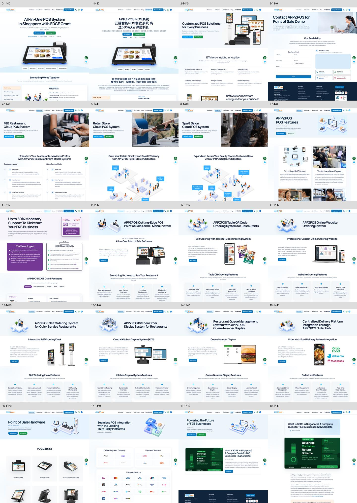

# APPZPOS visual refinement — 29 October 2026

Local work on `codex/impeccable-site-polish-20261029`, based on `349f880`.
No commit, push, or deployment was performed. Local development preview: http://127.0.0.1:4200/.

## Scope and direction

Used the Impeccable polish workflow to refine all 20 public routes, preserving the blue/navy brand, imagery, factual copy, routes, contact destinations, forms, metadata, and tracking. This is a refinement of the existing site, not a replacement design.

- Consistent Manrope headings, less compressed tracking, stronger section hierarchy, and more breathing room between homepage sections.
- Higher-contrast primary actions and consistent control shapes, with green retained for WhatsApp.
- Simplified product backgrounds, capability surfaces, and floating contact controls.
- Readable enquiry labels and a white form surface; better article reading measure.
- Navy footer with larger touch targets, legible links, and clearance for fixed controls.
- Persistent demo shortcut appears after the opening view and yields while conversion forms are visible or focused.
- Closed navigation dropdowns no longer expose invisible keyboard targets.
- Fixed the custom-solutions mobile overflow and removed decorative capability numbering. Four existing hero labels now follow the main heading as supporting text; their wording is unchanged.
- Scroll-reveal sections remain visible by default; the existing interactive product demonstration retains its animation.

## Verification

- Production Angular build passes; existing bundle-size, CSS-size, selector and template warnings remain. Budget limits were not increased.
- 29 focused Angular shell tests pass, including dropdown visibility and persistent CTA/form priority.
- Tracking-preservation check passes.
- Chinese homepage contract passes: 142 phrases, 10 routes, 112 images, 2 metadata values, 9 hooks.
- All 20 routes checked at 320, 375, 768, 1024, and 1920px: no document overflow or clipped H1 text (100 route/viewport combinations).
- Full-page captures on every route at 1440px and 390px; mobile confirmation reports no document overflow, page-script errors, or completed-but-broken images.
- Compared links and form field names/types against the pre-change rendered baseline: unchanged.
- Browser checks pass for desktop dropdown/Escape, mobile menu, homepage industry switching (after its existing 480ms transition), demo CTA visibility, empty-form validation without API submission, and blog demo dialog dismissal.
- Impeccable mechanical scan run once. Corrected legacy font fallbacks, decorative grid backgrounds, and the thick blockquote accent. The Instagram brand icon's existing gradient is intentional; Angular `[src]` bindings triggered two static false positives and resolved correctly in the browser.
- `git diff --check` passes.

## Existing limitations

The broad `test:site-content` script reports the same 39 wording mismatches found before changes. It was not re-baselined to hide those failures. External map loading is not validated by the visual review. Forms were checked with invalid/empty input only; no real enquiry was sent. Browser verification used Chromium, not a physical-device or Safari test.

## Visual overview

The tiles follow the route order below. These captures cover the opening sections; full-height working captures and audit logs are in `/private/tmp/appzpos-polish/` for this session.

0. English homepage
1. Chinese homepage
2. Custom solutions
3. Demo/contact
4. Restaurant
5. Retail
6. Salon
7. Features
8. EDGE Grant
9. POS / E-Waiter
10. QR ordering
11. Website ordering
12. Self-order kiosk
13. Kitchen display
14. Queue display
15. Order Hub
16. Hardware
17. Partner integrations
18. Blog index
19. BCRS article
